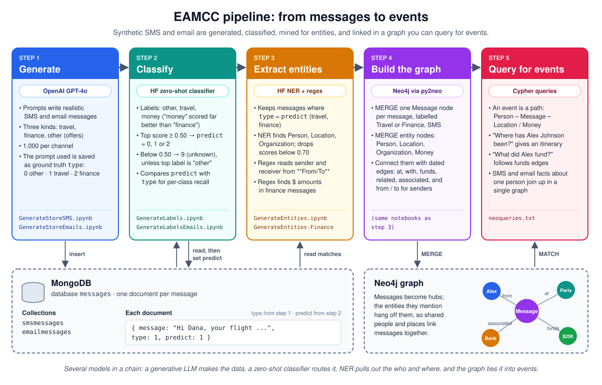

# Event Acquisition from Multiple Common Communications

This project uses various LLMs in a pipeline to uncover events.

## File Descriptions
- GenerateStoreEmails.ipynb and GenerateStoreSMS.ipynb: Generate sythetic data and insert in mongoDB noting the type (Finance, Travel, or Other)
- GenerateLabels.ipynb and GenerateLabelsEmails.ipynb: Determine Categoization of communication either Finance, Travel, or Other
- GenereateEntities.ipynb and GenerateEntities-Finance.ipynb: Uncover entites of Person, Location, or Organization and store in neo4J graph

